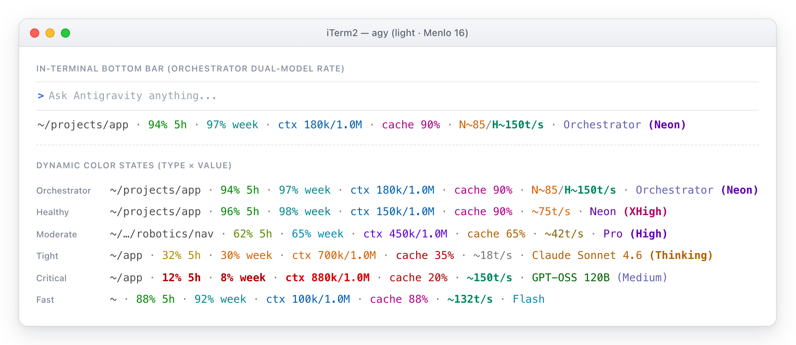
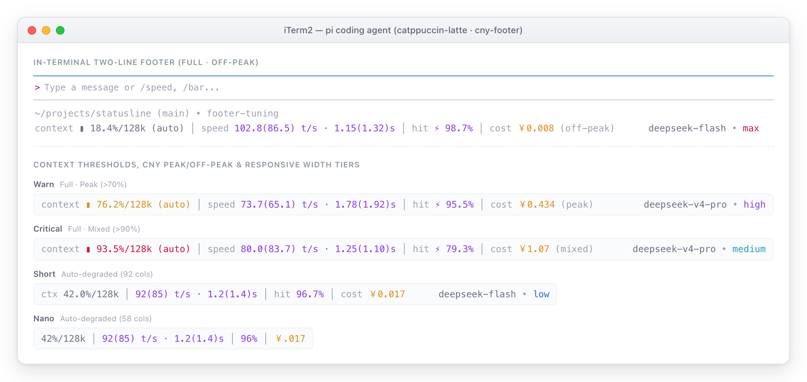

# statusline

个人终端 AI Agent 底部状态栏配置集合，包含 **Antigravity CLI (`agy`)** 与 **pi coding agent (`pi`)** 两套独立配置。

## 目录结构

```text
statusline/
├── agy/
│   ├── statusline.py          # Antigravity CLI 单行状态栏脚本（Python 3 零依赖）
│   ├── settings.example.json  # ~/.gemini/antigravity-cli/settings.json 配置片段示例
│   └── assets/
│       └── preview.png        # 终端渲染效果预览（浅色主题 256 色）
└── pi/
    ├── extensions/
    │   └── cny-footer.ts      # pi coding agent 自定义底部栏扩展（TypeScript）
    └── assets/
        └── preview.png        # 终端渲染效果预览（Catppuccin Latte 主题）
```

---

## 1. Antigravity CLI (`agy/`)

浅色主题（Light / Solarized Light）友好的 256 色 ANSI 单行状态栏，按**指标类型**与**当前数值区间**双维度着色，支持 `NO_COLOR` 环境变量降级与异常兜底。

- **精准测速**：`tool_use`（跑命令 / 搜索）期间自动暂停计时，避免工具耗时拉低 `t/s`；采用近期采样 token 加权均值。
- **编排模式分模型测速**：选择 `Orchestrator (Neon / Argon / Carbon)` 时，增量读取 `transcript_path` 尾部按底层真实模型分桶统计，紧凑显示为 `N~85/H~150t/s`（Planner 置前、Executor 置后，各自独立着色；仅单角色运行过时显示 `N~85t/s`）。



显示顺序：

```text
cwd · 5h配额 · week配额 · ctx占用 · cache命中 · ~t/s速度（或 N~85/H~150t/s） · 模型(思考档位)
```

### 配色规则（256 色 ANSI）

| 字段 | 正常 / 高态 | 中档 | 偏低 / 偏紧 | 危急 / 极速 |
|---|---|---|---|---|
| **cwd** | 石板灰 `239` | — | — | — |
| **5h 配额** | `>=80%` 森林绿 `28` | `50–79%` 橄榄绿 `64` | `20–49%` 琥珀 `136` | `<20%` **加粗深红** `1;124` |
| **week 配额** | `>=80%` 深青 `30` | `50–79%` 湖蓝 `31` | `20–49%` 焦糖橙 `166` | `<20%` **加粗深红** `1;124` |
| **ctx 占用** | `<30%` 宝蓝 `25` | `30–59%` 靛紫 `56` | `60–79%` 深橙 `166` | `>=80%` **加粗红** `1;160` |
| **cache 命中** | `>=80%` 梅紫 `126` | `50–79%` 暖棕 `130` | `<50%` 砖红 `124` | 无数据淡灰 `244` |
| **~t/s 速度** | `<25` 淡灰 `243` | `25–59` 铜棕 `94` | `60–119` 琥珀橙 `166` | `>=120` **加粗翠绿** `1;29` |
| **model** | Orchestrator 蓝紫 `61` · Neon/Pro/Argon/Carbon 靛紫 `55` · Flash/Hydrogen 青蓝 `31` · Claude 暖陶橙 `130` · GPT 墨绿 `22` | — | — | 档位 / Planner：`(XHigh)` **加粗莓红** `1;125` · `(High/Thinking)` **家族加粗** · `(Medium)` 柔蓝紫 `61` · `(Low)` 淡灰 `244` |

### 安装

```bash
mkdir -p ~/.gemini/antigravity-cli
cp agy/statusline.py ~/.gemini/antigravity-cli/statusline.py
chmod +x ~/.gemini/antigravity-cli/statusline.py
```

在 `~/.gemini/antigravity-cli/settings.json` 中合并以下配置（注意将路径替换为本机绝对路径，参考 `agy/settings.example.json`）：

```json
{
  "statusLine": {
    "type": "command",
    "command": "/usr/bin/python3 /ABSOLUTE/PATH/TO/.gemini/antigravity-cli/statusline.py",
    "enabled": true
  }
}
```

---

## 2. pi coding agent (`pi/`)

`pi/extensions/cny-footer.ts` 为 pi coding agent 的双行自定义底部状态栏扩展：



- **第一行**：工作目录 (`~` 缩写) + Git 分支 + 会话名（窄屏依次自动降级）
- **第二行**：`context │ speed │ hit │ cost` + 右侧模型名与思考等级
- **人民币峰谷计费**：针对 DeepSeek 官方模型按每条消息时间戳区分北京时间高峰/空闲价计费；其他厂商回退为美元成本 × 汇率（默认 `7.2`，可用 `PI_CNY_RATE` 覆盖）
- **速度与首字延迟**：区分 TTFT 与纯解码 `t/s`，同时显示 `均值(当前)`，并持久化到会话记录以支持 `/reload` 恢复
- **内置斜杠命令**：
  - `/speed [all]`：查看首字延迟与生成速度报告（带 `all` 看逐条明细）
  - `/bar [auto|full|short|nano]`：切换底部栏信息密度档位

### 安装

```bash
mkdir -p ~/.pi/agent/extensions
cp pi/extensions/cny-footer.ts ~/.pi/agent/extensions/cny-footer.ts
```

复制后重启 `pi` 或在 TUI 内执行 `/reload` 即可生效。
