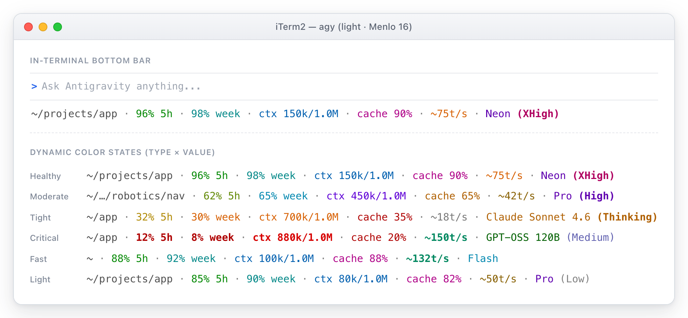
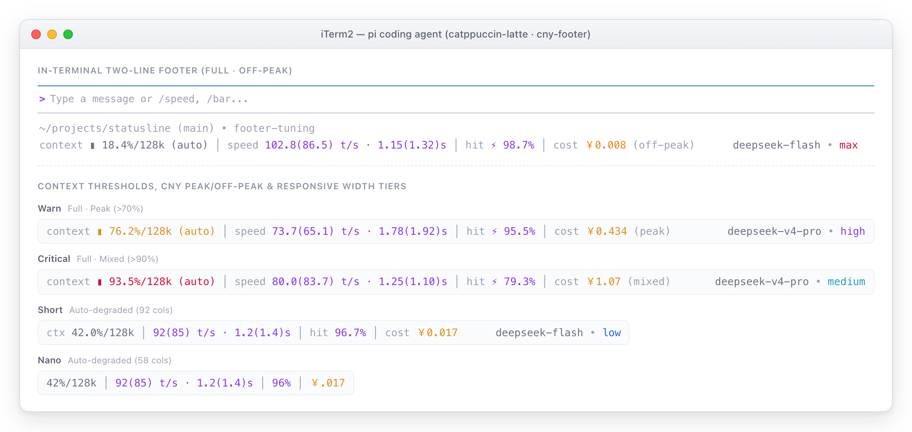

# statusline

[English](./README.md)

面向 **Antigravity CLI (`agy`)** 与 **pi coding agent (`pi`)** 的简洁终端状态栏配置。

## Antigravity CLI (`agy`)

浅色主题（`Light` / `Solarized Light`）友好的 256 色单行状态栏，Python 3 零依赖。



- **按类型 × 数值双维着色**：`cwd`、`5h`、`week`、`ctx`、`cache`、`t/s` 与 `model`（含思考档位）各用独立色系，随数值动态变色。
- **剔除工具耗时**：`tool_use` 期间自动暂停计时，采用近期采样 token 加权均值。
- **编排模式分模型测速**：增量读取 `transcript_path`，按底层真实模型分桶展示（如 `N~85/H~150t/s`）。
- **窄屏自适应**：按 `terminal_width` 四档渐进简略（完整 → 紧凑 → 缩写 → 逐项精简），窄分屏不折行、不截半词。

**一行安装：**

```bash
mkdir -p ~/.gemini/antigravity-cli && curl -fsSL https://raw.githubusercontent.com/Hiaa1/statusline/main/agy/statusline.py -o ~/.gemini/antigravity-cli/statusline.py && chmod +x ~/.gemini/antigravity-cli/statusline.py && python3 -c 'import json,pathlib as P; d=P.Path.home()/".gemini/antigravity-cli"; p=d/"settings.json"; s=json.loads(p.read_text()) if p.exists() else {}; s["statusLine"]={"type":"command","command":f"/usr/bin/python3 {d}/statusline.py","enabled":True}; p.write_text(json.dumps(s,indent=2)+"\n")'
```

> 或直接让 Agent 装：`帮我安装 https://github.com/Hiaa1/statusline 里的 agy statusline`

---

## pi coding agent (`pi`)

双行自定义底部状态栏扩展（`pi/extensions/cny-footer.ts`），支持按终端宽度自动降级。



- **双行布局**：第一行 `目录 (分支) • 会话名`，第二行 `context │ speed │ hit │ cost` + 右侧 `模型 • 思考等级`。
- **人民币峰谷计费**：内置 DeepSeek 官方北京时间峰谷价，其余模型按美元 × `PI_CNY_RATE`（默认 `7.2`）回退。
- **速度与命令**：记录首字延迟与纯解码 `均值(当前)` 并支持 `/reload` 恢复；内置 `/speed [all]` 与 `/bar [auto|full|short|nano]`。

**一行安装：**

```bash
mkdir -p ~/.pi/agent/extensions && curl -fsSL https://raw.githubusercontent.com/Hiaa1/statusline/main/pi/extensions/cny-footer.ts -o ~/.pi/agent/extensions/cny-footer.ts
```

> 安装后重启 `pi` 或执行 `/reload`。也可直接让 Agent 装：`帮我安装 https://github.com/Hiaa1/statusline 里的 pi statusline`
